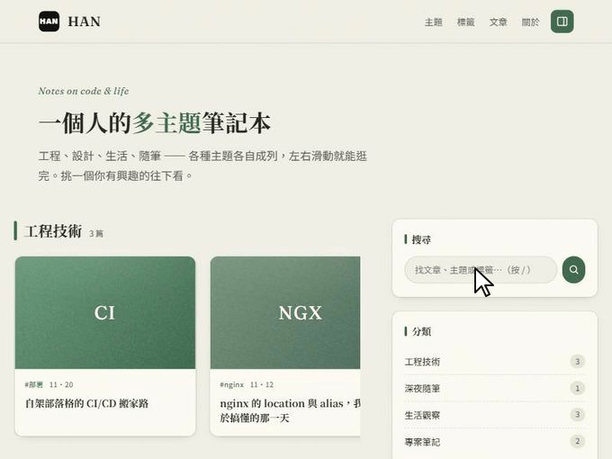
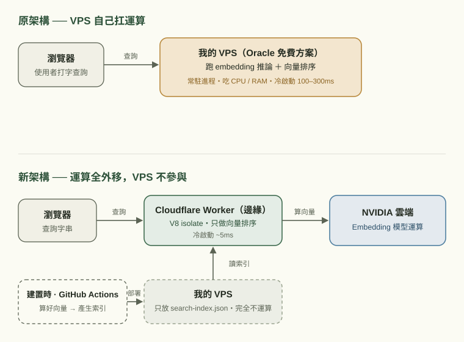

我想幫這個部落格加一個搜尋，想要能更智慧化懂搜尋——打「怎麼把網站搬到自己的主機」，就算文章裡沒出現這幾個字，也能找到那篇講 CI/CD 搬家的。

先放結果：

<figure style="margin:1.5rem 0">
  
  <figcaption style="font-size:.85rem;color:#5b6354;margin-top:.5rem">打查詢 → 跳出結果 → 點進文章。整段用線上站實錄；查詢字一個關鍵字都沒對到，CI/CD 那篇照樣排第一。</figcaption>
</figure>

麻煩的是：這站是 Astro 純靜態站，沒有後端可以接查詢；而我的 VPS 是 Oracle 免費方案，很小，我不想在上面常駐一個吃 CPU、吃記憶體的服務。

想了一陣子，結論就一句話：**這台機器太小了，所以減少服務、把運算外移。**

## 三方分工

一次搜尋，其實是三個角色接力：

<figure style="margin:1.5rem 0">
  
  <figcaption style="font-size:.85rem;color:#5b6354;margin-top:.5rem">原本想在 VPS 上扛，後來把運算全部推出去。</figcaption>
</figure>

- **瀏覽器**：使用者打字。
- **Cloudflare Worker**：呼叫 NVIDIA 把查詢算成向量，再對預先建好的索引做 cosine 排序，回傳最像的幾篇。
- **NVIDIA 雲端**：embedding 模型真正在這裡算（`nvidia/nemotron-3.5-embed-1b`，中英文都吃，用 build.nvidia.com 的免費端點）。

講白一點：**embedding 不是跑在我的 VPS，也不是跑在 Cloudflare，是在 NVIDIA 那邊。** Worker 只是一層很薄的殼，把查詢轉出去算、拿回向量後對一個小陣列做點積。

**沒有模型、沒有 GPU、沒有常駐，運算全部轉出去。**

## 為什麼不乾脆在 VPS 上跑

我想過土法：用 systemd 的 socket activation，有人搜才叫醒服務。但在小 VPS 上 fork 一個 Node process，冷啟動要 100～300ms，醒著還是吃資源。

Cloudflare Worker 就不一樣了。它不會真的幫你開一台 container，而是把程式碼塞進 V8 isolate 裡跑——說穿了，引擎本來就一直在邊緣節點上開著，你的東西進來只是借個位子、開個很輕的小沙箱，所以冷啟動快到幾乎沒感覺，大概就 5ms。我最在意的其實只有一點：**這些完全不佔我 VPS。**

## 建索引 vs 查詢

真正在算的只有兩個時機，用的 `input_type` 還不一樣：

- **建置時**（GitHub Actions）：一支腳本讀過所有 Markdown，用 `input_type: "passage"` 把每篇算成向量，輸出 `search-index.json` 跟著網站一起部署。它會對內容算 hash 存快取，只重算改過的那幾篇，省免費額度。
- **執行時**：Worker 用 `input_type: "query"` 算查詢向量，對索引 cosine 排序。

## 順手加的容錯

串外部 API，遲早會出事——模型被下架、額度用完、key 填錯、網路抽風。我乾脆一開始就當它會壞，再想壞的時候要怎麼表現。

一是**錯誤要看得懂**。Worker 呼叫 NVIDIA 時，我把回應的 status 跟 body 都印出來，再依狀態碼補一句人話：

```js
if (!res.ok) {
  const body = await res.text().catch(() => "");
  console.error(`[han-search] NVIDIA ${res.status}: ${body.slice(0, 600)}`);
  // 401=key 錯、402/429=額度用完、404=模型名錯、400=請求格式錯
}
```

這樣不管是模型被下架回的 `410`、還是參數寫錯回的 `400`，看一眼 log 就知道是哪種，不用對著一句「search failed」瞎猜。

二是**建置別被它拖垮**。建索引的腳本要是抓不到 NVIDIA 的 key，不會讓整個網站 build 失敗，而是先寫一份「向量留空」的索引頂著——網站照常上，等 key 補上重建一次就好。

串第三方 API，容錯最好一開始就算進設計裡，別等出事才補。

現在上線一陣子了，中英文查起來都還準。

回頭看，真正要我自己顧的其實只有兩樣：一份跟著網站發佈的靜態 `search-index.json`，和一支很薄的 Worker。
運算都在別人家跑，這台小 VPS 幾乎沒事做——能不操它，就不操它。


