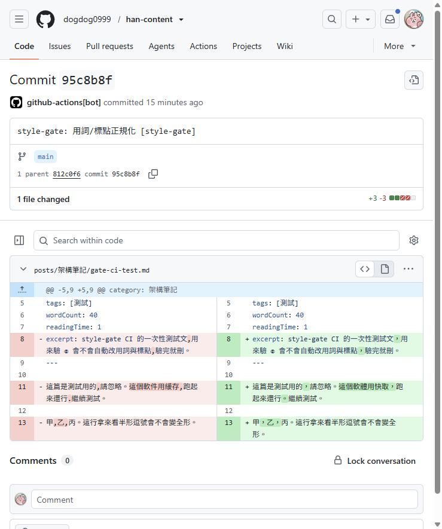
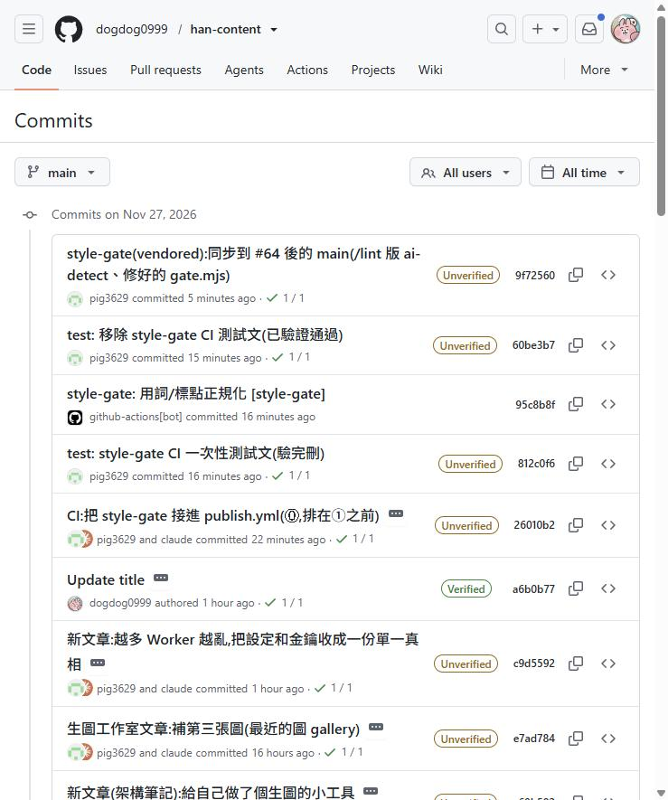
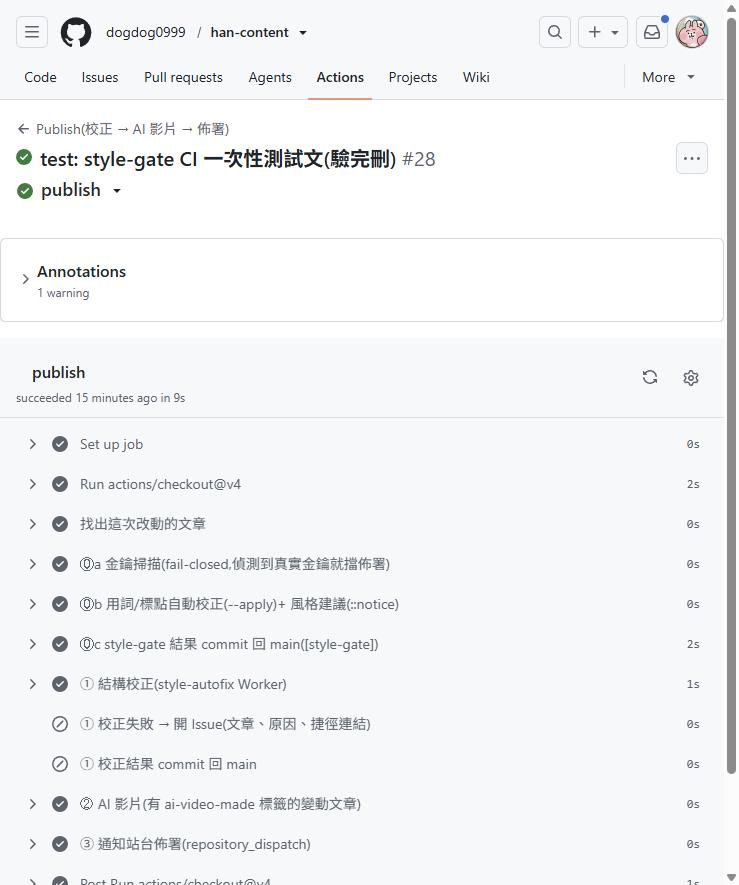
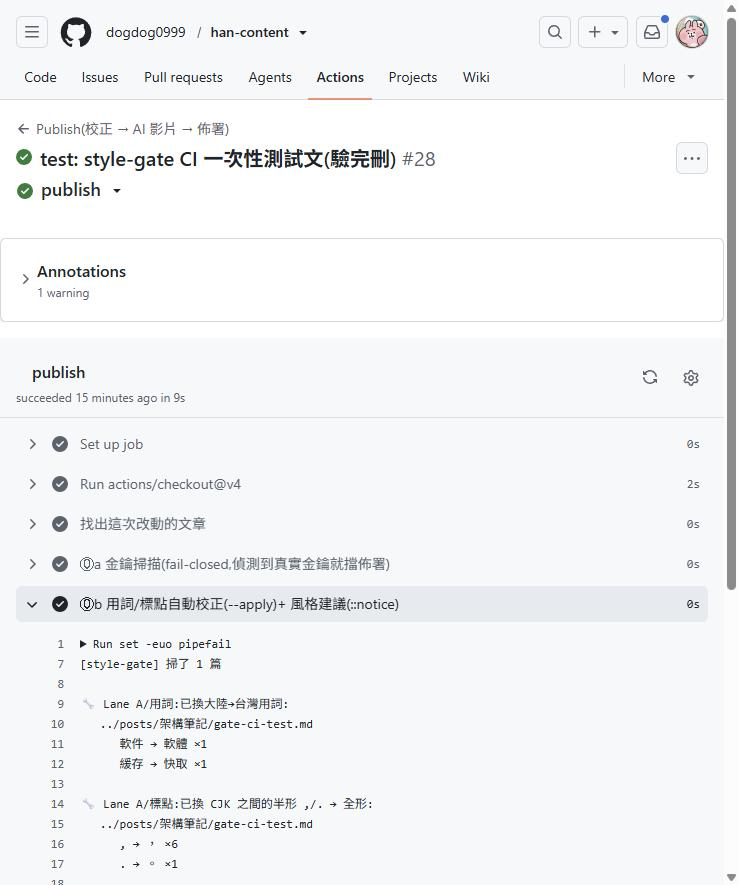
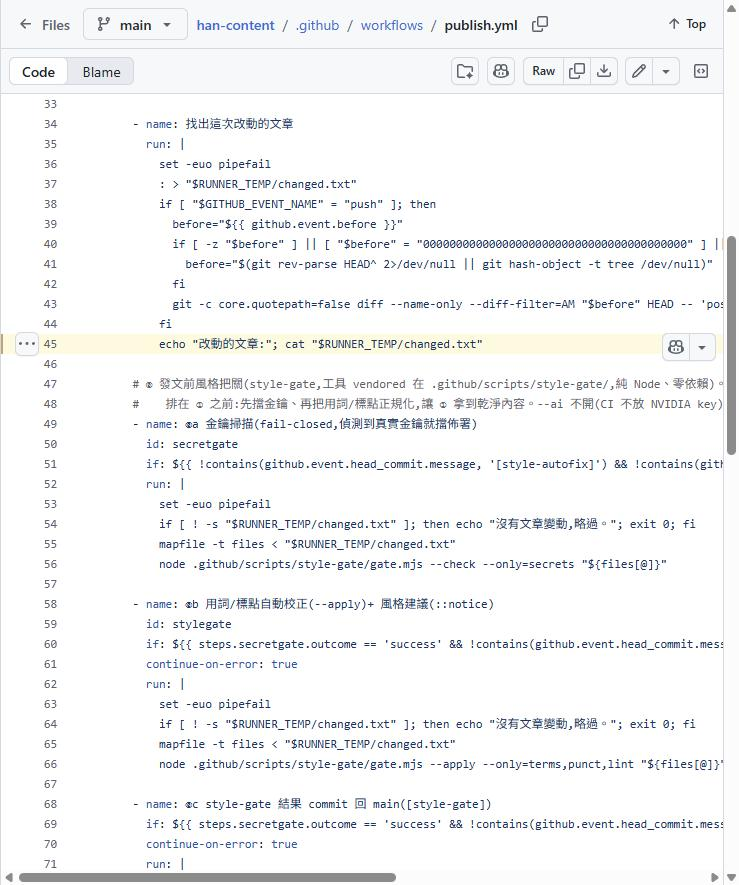
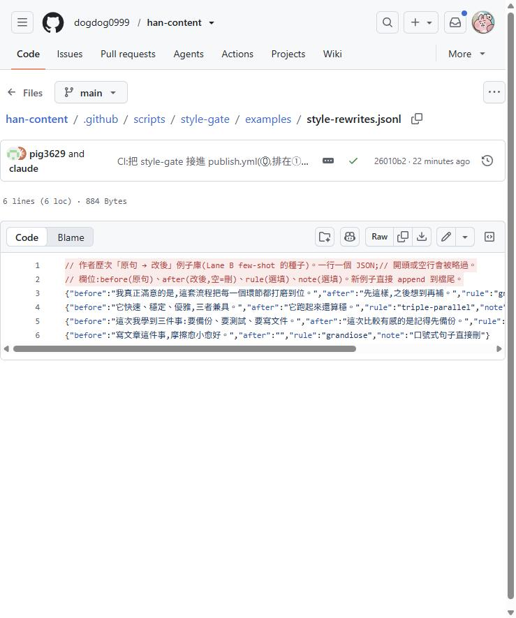

[上篇](/bloger/posts/架構筆記/ai-auto-correct-why/)講了分兩條路的想法。這篇直接推一篇故意寫壞的文，看它跑起來長什麼樣。

先放結果。我推了一篇內文有 `軟件`、`緩存` 和半形逗號的測試文，CI 自己把它改好、commit 回來：

<figure>

<figcaption>紅 → 綠，`軟件` 變軟體、`緩存` 變快取、半形逗號變全形，而且 commit 的人是 github-actions[bot]。</figcaption>
</figure>

整個過程沒有我插手。我只 push 了測試文，下一個 commit 就是 bot 自動校正的：

<figure>

<figcaption>我推文、bot 緊接著校正，兩個 commit 連在一起。</figcaption>
</figure>

## CI 裡那一排把關

發文會觸發一條 workflow，校正排在最前面。這是這次跑的步驟：

<figure>

<figcaption>⓪ 先把關（金鑰、用詞、標點），再輪到後面的結構校正與佈署。</figcaption>
</figure>

點開校正那一步，它老實印出改了哪些：

<figure>

<figcaption>換了哪些詞、幾個標點，一條條列出來。</figcaption>
</figure>

接進流程的方式，就是在原本的發文 workflow 前面插這一段：

<figure>

<figcaption>金鑰擋下、用詞標點寫回、再 commit，都是現成指令串起來的。</figcaption>
</figure>

## AI 那塊的料

前面這些都沒用到 AI。要動用 AI 的只有「哪句話值得拉成引用」這種判斷，而且配著一份我過去改稿的例子餵給它：

<figure>

<figcaption>「原句 → 改後」的例子庫，當 AI 的參考，之後也可能畢業成固定規則。</figcaption>
</figure>

跑了幾次下來，該機械處理的都機械掉了，我手動要調的剩沒幾個。先這樣，之後想到再補。
