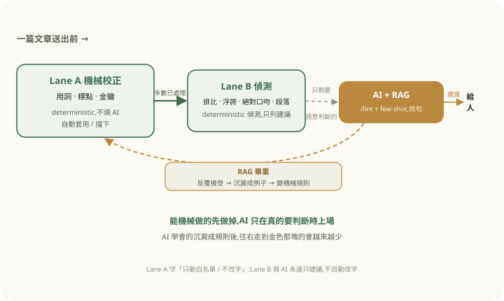

我寫完一篇文章，上線前總會回頭調幾件小事：把不小心寫成的大陸用詞改回台灣的講法、把半形逗號換成全形、看看有沒有太工整的排比、結尾是不是收得太滿。每次都手動弄，有點煩。

想把它自動化到「發文前」。但我第一個問題不是「要用哪個 AI」，而是——**這些事，哪些其實不需要 AI？**

先放結果：

<figure>

<figcaption>能機械做的先做掉，越往右（金色那塊 AI）輪到的越少。</figcaption>
</figure>

## 看定不定得出那條線

我這個部落格有一份自己的通則：**能不能安全放 AI 自動改，就看定不定得出那個「不變量」**——一條「AI 怎麼亂改都不准破壞」、而且程式驗得出來的規矩。

定得出，就讓程式自動做；定不出，就只讓 AI 提建議、我自己點頭。

照這條線，那幾件事自然分成兩邊。

## Lane A:定得出規矩的，機械做

- **用詞**（`軟件` → 軟體、`緩存` → 快取…）：只換白名單裡沒有歧義的詞，其他的都不碰。這條規矩程式驗得出來，所以自動套用。
- **全形標點**:只換「夾在兩個中文字之間」的半形逗號、句號。`Node.js`、`3.14`、網址裡的點號，鄰居都不是中文，天生碰不到。
- **金鑰外洩**:掃到像是真實金鑰的字串就擋下這次發佈，不自己刪（把真的外洩悄悄藏起來更危險）。

這三條都用不到 AI。能定出規矩，往往也就定得出做法，那用程式更穩、也更省。

## Lane B:定不出規矩的，AI 只建議

排比、對仗、浮誇結尾、口氣太硬——這些要動的是文字和語氣，守不住「正文一字不動」那條線。所以不自動改，只把疑點列出來、配一句建議，我自己決定要不要動。

真的需要語意判斷的（像是「哪一句值得拉成引用」），才交給 AI（走一個小 `/lint` 端點，金鑰留在雲端、不進 CI）。再配一份我過去「原句 → 改後」的例子庫，讓它越抓越準。

## 會自己縮小的那塊 AI

這裡還留了一條回路：AI 建議裡我反覆接受的那些改法，會被記成例子；某個模式夠穩定了，就「畢業」成一條機械規則。之後那一類就用程式直接做，不必再問 AI。

所以這套東西越用，往右走到 AI 那塊的會越少。

先這樣。下篇放實際跑一次的畫面——CI 自動把用詞、標點改掉，長什麼樣子。
