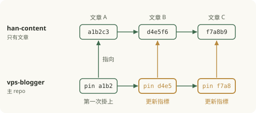

這是一篇乾淨的 Markdown,用來看 AI 會不會亂動結構。

## 先放結果

下面是一張圖:

<figure>

<figcaption>submodule 的指標每次都要多一個 commit</figcaption>
</figure>

## 指令

```bash
git submodule update --remote
git add content
git commit -m "bump content"
```

先這樣,測完就刪。
