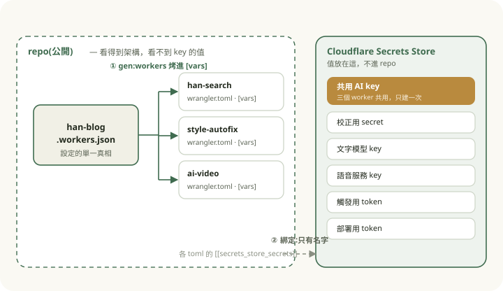

這部落格不知不覺長出三個 Cloudflare Worker：搜尋用的、幫文章做結構校正的、產 AI 影片和圖的。

每一個都有自己的 `wrangler.toml`，各自塞著一堆設定和金鑰。東西一多，就開始亂。

同一把 AI 服務的 key，三個 Worker 都要用；改一次模型名，得打開三個檔案到處翻。

金鑰更麻煩。它是用 `wrangler secret` 一條一條設在各自的 Worker 底下，我根本看不到全貌——哪個 Worker 要哪幾把 key，只能自己記。

## 先放結果

現在跑一個指令，就印出完整的金鑰架構（名稱已化名）：

```
$ npm run check:secrets

  搜尋 Worker      ← 共用 AI key
  校正 Worker      ← 共用 AI key、校正用 secret
  影片 Worker      ← 文字模型、語音、觸發、部署…

── 實際要建的 key(共用的只建一次)──
  共用 AI key   ← 3 個 Worker 共用
  …(其餘略)
```

哪個 Worker 要哪幾把 key、哪些是共用，一眼就看完。

## 分兩層，各有各的真相

我把設定拆成兩種，因為它們「該放哪」本來就不一樣。

<figure>

<figcaption>設定值會落進 repo（實線）；金鑰的值留在 Cloudflare，repo 只拿到名字（虛線）。</figcaption>
</figure>

**非機密設定**（模型名、API 網址、語音、儲存桶名⋯）的真相，放在一份 `config/han-blog.workers.json`。

跑 `npm run gen:workers`，它會把這些值烤進各個 `wrangler.toml`，只動兩行哨兵之間的生成區，哨兵外手寫的部分不去動它。

**金鑰**的真相，放在 Cloudflare 的 **Secrets Store**（帳號層級的金鑰庫，一把 key 建一次、多個 Worker 綁過去）。那份 json 只宣告「哪個 Worker 綁哪把 key」的名字，值不放進 repo。

這個 repo 是公開的，所以這條界線我蠻在意：

> 設定值會落進 repo，金鑰的值留在 Cloudflare。repo 看得到的只有架構。

## 為什麼這樣設計

**改一處，其他都是生成物。**

改個共用的模型名，只動 json 一行，`gen:workers` 一跑，用到它的 Worker 都跟著變；忘了重生成，CI 也會擋下來。

搬金鑰的時候也不用停機。Worker 讀 key 走一個相容的小工具，新的 Secrets Store 綁定和舊的 `wrangler secret` 都吃，可以先上程式、再慢慢搬 key。

## 踩到的一個小坑

`check:secrets` 的線上對帳，本來在我自己電腦上跑不起來。

腳本寫死去叫全域的 `wrangler`，但我這台只裝了 npx 版的，直接找不到；Windows 還多擋一層，不讓你直接開 `.cmd` 執行檔。

後來改成「先找全域的，沒有就退回 `npx wrangler`」才通。要注意：本機工具別假設環境裡一定有某支全域指令。

## 收尾

現在 Worker 再多，我要顧的大概也就那一份 json，和「哪把 key 綁在哪」的宣告。

其餘的 toml 區塊都是生成出來的，金鑰的值就不歸這個 repo 管。先這樣，之後想到再補。
