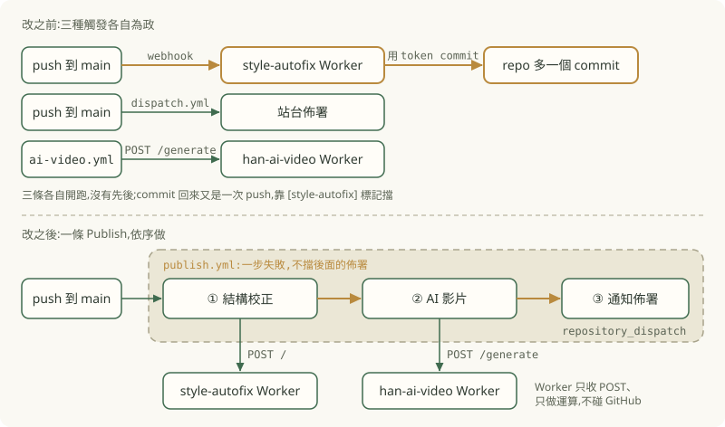

發文之後會跑三件事：結構校正、AI 影片、佈署。佈署和 AI 影片走 CI，結構校正卻是 GitHub 的 **webhook**（有事件就主動打網址通知）直接打 Cloudflare Worker，由它拿 token 讀文章、commit 回 repo（[上](/bloger/posts/架構筆記/deploy-style-autofix/)、[下](/bloger/posts/架構筆記/deploy-style-autofix-webhook/)）。能跑，但三種觸發混著用。

## 先放結果

現在 push 到 `han-content` 的 `main`，只觸發一條 `Publish`，依序做 ① 校正、② AI 影片、③ 通知站台佈署。

推兩篇測試文章：

- **A**：滿是 inline style 的 HTML，被校正成乾淨 Markdown，文字一字不少，由 bot commit 回 `main`。
- **B**：乾淨 Markdown，AI 改了字，被逐字比對擋下，保留原文。

AI 影片沒被誤觸發，bot 的 commit 之後也沒再跑第二次 `Publish`。

<figure>

<figcaption>上面三條各自開跑，下面一條照順序走。</figcaption>
</figure>

## 為什麼要改

- **沒有順序。** 佈署可能在校正 commit 回來前就跑完，又得多佈署一次。
- **靠標記防迴圈。** Worker 的 commit 也是 push，訊息得帶 `[style-autofix]`。
- **Worker 保管三把密鑰。** 驗 webhook、讀寫 GitHub、呼叫 NVIDIA。
- ** 集中管理 ** 方便控制成本。

現在 Worker 只剩 `POST /`，不碰 GitHub。用 CI 內建身分（`GITHUB_TOKEN`）push 的 commit 不會再觸發 workflow，所以不用標記，也不會多佈署一次。

## 取捨

另一條路是全交給 Worker，連佈署也由它通知，但 Worker 要放更多邏輯和密鑰。
選 CI 的代價是多用一點 Actions 分鐘，且 workflow、Worker、文件要一起改。

