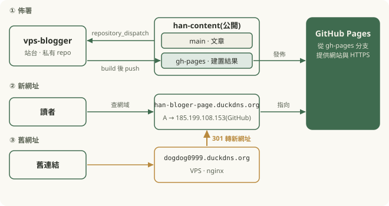
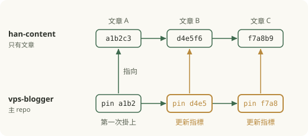

這個部落格原本是文章跟站台程式放同一個 repo,最後 rsync 到我自己的 VPS。想發一篇廢文也得開分支、等 CI、再 merge。

後來我把它改成三塊:一個放文章的 repo、一個放站台的 repo,加上 GitHub Pages。這篇主要在記這個結構,每一塊做什麼、怎麼接起來。

## 先看整體

<figure>

<figcaption>建置結果推到 gh-pages 由 Pages 發佈;新網址的 A 記錄指到 GitHub,舊網址留在 VPS 只做 301。</figcaption>
</figure>

三塊各管一件事。

`han-content`(公開)放文章跟圖,**沒開保護,想改就直接 commit**。它有兩個分支:`main` 是文章,`gh-pages` 是建置好的網站。

`vps-blogger`(私有)是站台本體:Astro 版型、搜尋、CI。**建置的時候才去把文章 clone 進來**,所以文章不在這個 repo 裡。

GitHub Pages 從 `han-content` 的 `gh-pages` 提供網站,連 HTTPS 憑證也是它簽。

## 怎麼串起來

發文章就一個動作:在 `han-content` 丟一個 `.md`,push 到 `main`。

內容 repo 有個很小的 workflow,push 時打一下 GitHub API,送一個 `repository_dispatch` 事件給站台。站台的 `deploy.yml` 多掛一個監聽:

```yaml
on:
  push:
    branches: [main]
  repository_dispatch:
    types: [content-updated]
```

收到之後 CI 把文章抓進來、建置、建搜尋索引,最後把結果推到 `han-content` 的 `gh-pages`。說穿了就是 webhook,只是兩邊都在 GitHub 裡。大概半分鐘,Actions 長這樣:

```text
✓ Notify site to deploy        (內容 repo)
✓ Build & Deploy               (站台:repository_dispatch 觸發)
  ✓ Build site
  ✓ Build search index
  ✓ Publish to GitHub Pages repo
```

為什麼結果要推回內容 repo,不直接用站台 repo 發佈?因為免費的 GitHub Pages 要公開的 repo,站台 repo 是私有的,內容 repo 本來就公開,剛好拿來放。

而且通知 workflow 只看 `main`,推 `gh-pages` 不會再叫醒站台,不會繞成一圈。

## 網域

網址是我自己的 DuckDNS 網域,不是 `github.io`。

新網址的 A 記錄指到 GitHub Pages 提供的 IP,在 Pages 設定填上這個網域,GitHub 的 DNS 檢查通過就會自動簽 HTTPS。DuckDNS 一個名稱只能填一個 IPv4,我只填了其中一個,實際上夠用。

舊網址還在 VPS 的 nginx 上,我加了一段 301,路徑原樣轉到新網址。等舊連結沒人用了,那台就能關掉。所以「0 伺服器」說的是網站本身,轉址這一段暫時還在。

## 為什麼不用 submodule

我有想過 submodule,也想過同一個 repo 分資料夾。

submodule 是 git 內建的功能,可以把另一個 repo 掛進主 repo 的某個資料夾,像這樣把文章 repo 掛在 `posts/` 底下。但主 repo 記的不是對方的檔案,只是「指到它的哪一個 commit」。所以內容 repo 每多一篇文章,主 repo 還得再 commit 一次,把指標更新過去,感覺沒有真的拆開。

<figure>

<figcaption>內容 repo 每多一篇,主 repo 就得多一個「更新指標」的 commit(金色那幾個)。</figcaption>
</figure>

分資料夾的話,保護規則還是同一套,回到原點。

所以就拆成兩個 repo,中間用一個事件接起來。內容那邊隨便我改,程式這邊保護照舊。

缺點也有:要多保管一把 PAT(內容 repo 用它發事件)和一把部署金鑰(站台 CI 用它推 `gh-pages`),而且本機要看完整的站,得把兩邊都拉下來。我寫了個 `pull-content` 腳本把文章抓回本機,算是湊合著解掉。

## 踩到的坑

嵌入向量的快取 key 是用文章內容算 hash,所以「抓文章」這步要排在快取之前,不然 key 永遠對不上,每次都整批重算。

站台這邊的 `src/content/posts/` 要 gitignore,不然本機殘留的舊檔會跟新抓的打架。

文章放進分類子資料夾之後,建搜尋索引的腳本只讀最上層,索引變成空的,搜尋什麼都找不到。後來改成遞迴讀,網址也帶上分類資料夾才對得起來。

先這樣。
