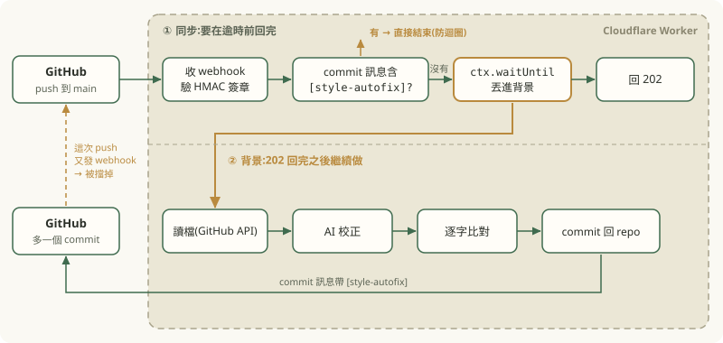

[上一篇](/bloger/posts/deploy-style-autofix/)做完，部署出來的頁面已經一定是乾淨的了。但 repo 裡那坨原始 HTML 還躺在那，我得自己把它 `curl` 進 Worker、看回傳的 diff、滿意了再手動 commit。

說真的，這沒比手動排版省多少力。我真正想要的是：**貼一坨 HTML、push，然後什麼都不用管**——它自己清、自己 commit 回來。

## 先放結果

前幾天我故意推了一篇很偷懶的文章上 `main`，內文就這樣：

```html
<div style="font-family:Arial;background:#f5f5f5;padding:30px">
<h1 style="color:#c0392b;font-size:38px">這段原本是一坨 HTML</h1>
<p style="font-size:13px;color:#888">我把這篇用簡單的 inline style 包起來…</p>
</div>
```

幾十秒後我 `git fetch`，repo 自己多了一個我沒打過的 commit：

```
f373756 style-autofix: 正規化 demo-auto.md [style-autofix]
f579ca1 Add demo-auto.md …          ← 我推上去的髒版
```

點進去，那篇在 repo 裡已經變成：

```markdown
## 這段原本是一坨 HTML
我把這篇用簡單的 inline style 包起來…
```

inline `style` 全不見、`h1` 變 `h2`，**文字一個字都沒少**。整段過程我沒碰任何東西。

## 串起來其實就一條線

`push` 到 `main` → GitHub 發一個 webhook 打到 Worker → Worker 校正這次改動的文章 → 用 token 把乾淨版 commit 回 repo → 既有的部署照常跑。

<figure>

<figcaption>Worker 分兩段:前面同步的先回 202,後面讀檔、校正、commit 在背景做;自己 commit 的 push 會再打一次 webhook,靠 commit 訊息的標記擋掉。</figcaption>
</figure>

有幾個地方想了一下才定案。

**保護用簽章，不用 Cloudflare Access。** Cloudflare 一直提醒我這個 Worker 沒套 Access。但 Access 那套是設計給「人登入」或「服務拿 token 來敲」的，而 webhook 是 GitHub 從外面主動打進來——套了 Access，第一個被擋在門外的就是 GitHub。webhook 的正規做法是 HMAC 簽章：GitHub 用我設的密鑰對整包 body 算一個 SHA-256 放進 header，Worker 這邊用同一把密鑰重算、逐字比對，不合就 401。手動那個入口才是用 Bearer 密鑰擋。

**先回 202，剩下的背景做。** GitHub 的 webhook 等不了太久，逾時就當失敗。但校正要呼叫一次 AI、再打 GitHub API 讀寫檔，來回好幾秒。所以 Worker 驗完簽章就馬上回 `202`，真正的校正跟 commit 丟進 `ctx.waitUntil` 背景跑。GitHub 收到快速的 ack，活還是做完。

`ctx` 是 Worker 入口 `fetch(request, env, ctx)` 的第三個參數。Worker 通常是回完 response 就收工，沒等完的非同步工作可能被中斷。`ctx.waitUntil(promise)` 就是跟 Cloudflare 說「回應先送出去，但先別收掉，等這個 promise 跑完」。

寫在 `workers/style-autofix/src/index.mjs` 的 `handleWebhook` 裡，就一行：

```js
async function handleWebhook(request, env, ctx) {
  // ……驗簽章、擋掉自己的 commit、整理出這次改動的文章……
  ctx.waitUntil(processFiles(env, files)); // 丟到背景，不等它
  return json({ ok: true, queued: files }, 202); // 馬上回
}
```

注意它丟進去的是「還沒 await 的 promise」，`processFiles` 在回完 202 之後才繼續跑，所以前面不能 `await` 它，不然又變成等好幾秒才回。

**全部留在 Cloudflare。** 校正的算力、讀寫 repo 的 API，全在 Worker；GitHub 只負責發一個 webhook。CI 的分鐘數一點都沒多花。

## 卡最久的，居然是挑模型

這套的容錯我一開始就鋪好了，結果派上用場的時機比想像中多——因為光是「找一個能用的模型」就踩了一輪：

- 第一個挑的 `llama-3.3-70b` 已經 EOL，直接回 410。
- 換一個 1T 的大模型，聰明是聰明，但跑太久，Cloudflare 直接 524 逾時。
- 再換一個推理型模型，它把思考過程寫得落落長，把輸出額度全花在「想」上，回來的文章內容是空的。

有意思的是這三種死法我一個都沒特別處理。**每一步只要不對，Worker 就回傳原文、標 `changed: false`**，站上該長怎樣還是怎樣。所以模型再怎麼鬧，最壞也只是「這篇沒被自動校正」，不會壞掉。

另外兩道網子：

- **防迴圈**：自動 commit 的訊息我都標上 `[style-autofix]`。Worker 收到 webhook 會先看這次 push 的 commit 訊息，看到這個標記就跳過——不然它改完自己又觸發自己，沒完沒了。
- **防呆**：最後我選的是一個很小、很快的模型。它處理簡單、中等的文章很乾淨，但遇到很複雜的版面偶爾會手滑改到一個字，這時逐字比對會抓到、退回原文。所以現在的實況是：**簡單中等的偷懶文會自己清，複雜的會被安全地「放著不動」**，等我哪天換到更穩的模型。

## 收尾

現在偷懶是真的可以偷懶了：貼一坨 HTML、push，剩下的它自己收。

但我還是沒把上一篇那個 build 期的 Layer 1 拿掉。webhook 會漏、模型會鬧、複雜文會被跳過——這些情況下，build 的時候那層永遠會再清一次。自動化負責「讓來源也變乾淨」，Layer 1 負責「反正站上一定乾淨」。兩個加起來，我才敢真的不管它。
