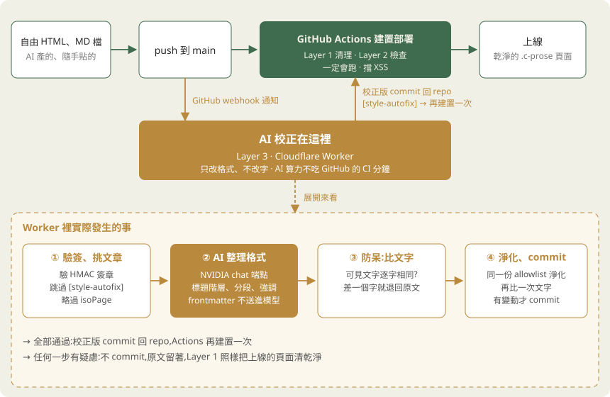
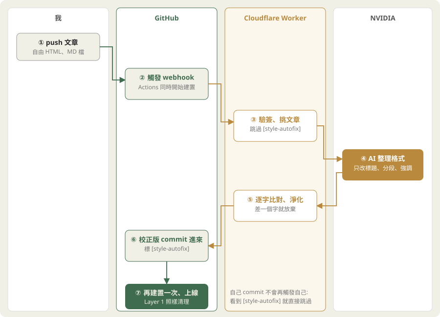

有時候我會偷懶：直接叫 AI 產一整坨 HTML 當文章貼進來。

結果就是一堆 inline `style`、亂 class、超大的 `<h1>`，偶爾還夾一段 `<script>`，貼上去跟整站格格不入。

我不想每次手動收拾，所以讓**部署的時候自動清乾淨**，整理的部分也交給 AI。

## 先放結果

我故意推了一篇用 inline style 包起來的文章：

```html
<div style="font-family:Arial;background:#f5f5f5;padding:30px">
<h1 style="color:#c0392b;font-size:38px">這段原本是一坨 HTML</h1>
<p style="font-size:13px;color:#888">我把這篇用簡單的 inline style 包起來……</p>
</div>
```

過一陣子，repo 裡自己多了一個標著 `[style-autofix]` 的 commit，檔案變成：

```markdown
## 這段原本是一坨 HTML
我把這篇用簡單的 inline style 包起來……
```

這個 commit 不是我下的，是 Cloudflare 上的 Worker 讀了文章、請 AI 整理完自己 commit 回來的。

**容器、`h1`、inline style 都被整理掉，文字一個字沒少。**

## 三層，各管一件事

- **Layer 1：build 期正規化**。Astro 的 rehype 外掛，永遠會跑，也是唯一負責安全的那一層。
- **Layer 2：CI 快速檢查**。掃原始 `.md`，回報哪幾篇是偷懶 HTML，不擋部署。
- **Layer 3：AI 格式校正**。跑在 Cloudflare Worker，push 後由 webhook 觸發，整理完自動 commit 回來。

<figure>
  
  <figcaption>整體流程。金色是 AI 校正，綠色的建置清理一定會跑。</figcaption>
</figure>

**就算 Layer 3 不跑、或 AI 亂來，上線的東西一定是乾淨的**，因為 Layer 1 是最後防線。

## 為什麼走解析樹，不用 regex

用 regex 淨化 HTML 是出了名的 XSS 地雷，標籤寫怪一點就繞過去了。所以我走 hast 樹（解析後的語法樹），規則集中在一份 allowlist：

- 危險標籤（`script`、`iframe`、`form`…）連子節點整個移除。
- 不認識的標籤（`section`、自訂元素…）**unwrap**：拿掉標籤、留下內容。
- 允許的標籤只留 `href`、`src`、`alt` 等屬性，`javascript:` 之類的網址直接拔掉。

唯一破例是多裝了 `rehype-raw`：Astro 預設把內嵌 HTML 當整塊字串，樹上看不到 `<div style=…>`。它只是解析器，「什麼算乾淨」還是我的 allowlist 說了算。`isoPage: true` 的文章和 `works/` 直接略過。

## AI 為什麼放 Cloudflare，而且只做格式化

放在 GitHub Actions 會吃每月的 CI 分鐘，CI 也會變慢。搜尋後端本來就是 Cloudflare Worker，乾脆沿用，由它呼叫 NVIDIA 的 API 端點。

觸發靠 GitHub 的 push webhook：Worker 驗簽、挑出改動的文章、請 AI 整理，再用 GitHub API 把乾淨版 commit 回去，部署流程就再 build 一次。

<figure>
  
  <figcaption>一次 push 之後，各方各做了什麼。</figcaption>
</figure>

容易忘的是**自己 commit 會再觸發自己**，所以訊息帶 `[style-autofix]` 就跳過，有變動才 commit。webhook 先回 202，工作丟到背景，GitHub 才不會逾時。

這一步我讓 AI 做的是**格式化，而且全自動**：整理標題階層、分段、強調一致，把帶 inline style 的容器拆掉，整理完直接 commit，我不用看、不用手動貼。

既然是全自動，就只剩一件事要顧：它不能順手把內容也改了。所以旁邊放了幾道檢查：

1. frontmatter 原樣保留，不送進模型。
2. 用 `textSignature` 把 markup 跟空白收斂成純文字，**逐字比對**，差一個字就退回原文。
3. AI 的輸出再過一次跟 Layer 1 **同一份 allowlist** 的淨化，淨化完再比一次。
4. 任何一步有疑慮就不 commit，Layer 1 照樣清乾淨。

這樣 AI 可以放心自動跑：它只能動格式，內容不變，也夾帶不了 XSS。入口也有擋：webhook 驗 HMAC 簽章，手動校正要帶共用密鑰，否則 401。

## 踩到的小坑

- 正規化一開始把 `<pre>` 裡 Shiki 上色的 style 也砍了，程式碼區塊變一片白，後來讓 `<pre>` 內部例外保留。
- AI 校正一開始回空內容。Qwen 和 Nemotron 是會先「思考」的推理型模型，思考把輸出額度吃光，文章一長就變空字串。後來在 system prompt 關掉思考（Nemotron 用 `detailed thinking off`），`max_tokens` 拉到 8192，現在預設用 `nvidia/nemotron-3.5-bolt-e4b`。
