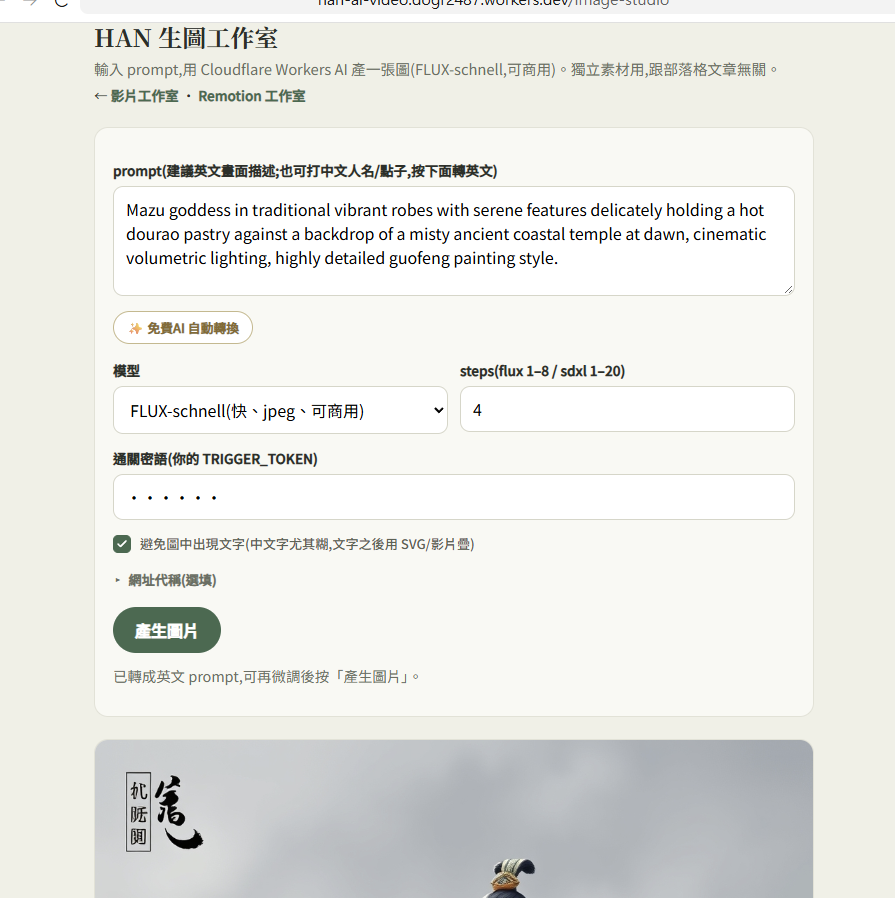
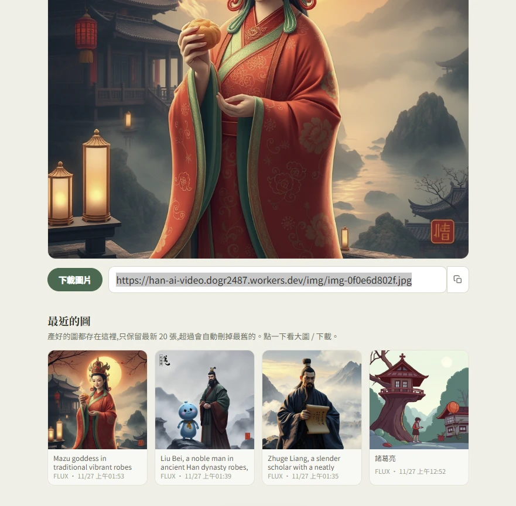

做完影片工作室，我又順手做了個**生圖工作室**。

起因很實際：做影片、寫文章常要配一張圖，網路上抓的有版權疑慮，自己畫又沒那個手。所以想要一條「**自己生、而且能商用**」的路。

先放結果（我打「媽祖」生的）：

<figure>
  
  <figcaption>打「媽祖」、按轉換翻成英文、再產生——幾秒一張。</figcaption>
</figure>

用法跟影片工作室一樣：丟一句 prompt、按產生，幾秒出一張。prompt 建議用英文描述畫面；但我懶得想英文的時候，直接打中文（像「媽祖」），按下面的「✨ 免費AI 自動轉換」就幫我翻成英文 prompt 再生。

<figure>
  
  <figcaption>填一句、按免費AI 自動轉換、選 FLUX-schnell、產生圖片。</figcaption>
</figure>

背後是 **Cloudflare Workers AI** 的 FLUX-schnell，在免費額度內、而且可商用——跟影片工作室同一套技術棧，不用另外養機器、也不用再翻圖庫。

一個小地方：我預設勾了「**避免圖中出現文字**」。AI 畫中文字常常糊成一團，乾脆讓它別畫字，標題跟名字之後再用 SVG 疊上去。

產好的圖都留在「最近的圖」，只存最新 20 張、超過自動刪最舊的——它就是個臨時素材夾，不是相簿。

<figure>
  
  <figcaption>「最近的圖」留最新 20 張，點一下看大圖 / 下載。</figcaption>
</figure>

目前拿來當自己的素材產生器剛好夠用。先這樣，之後想到再補。
