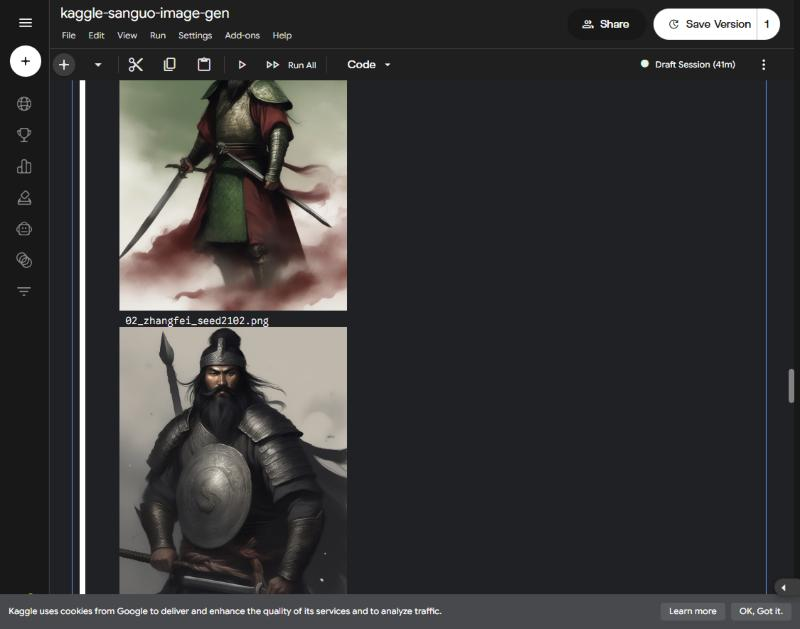
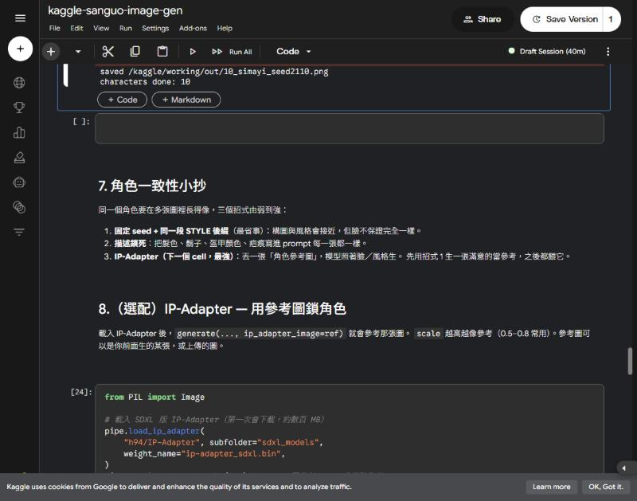
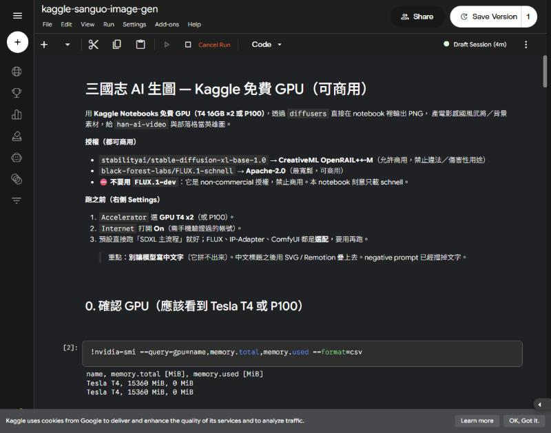
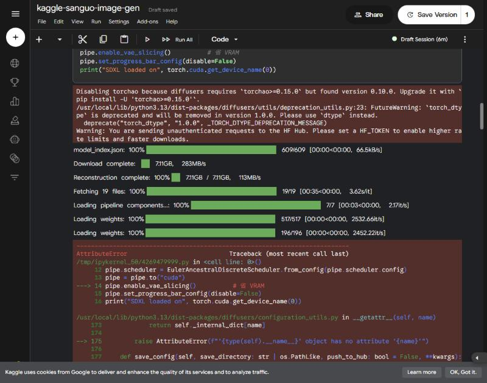
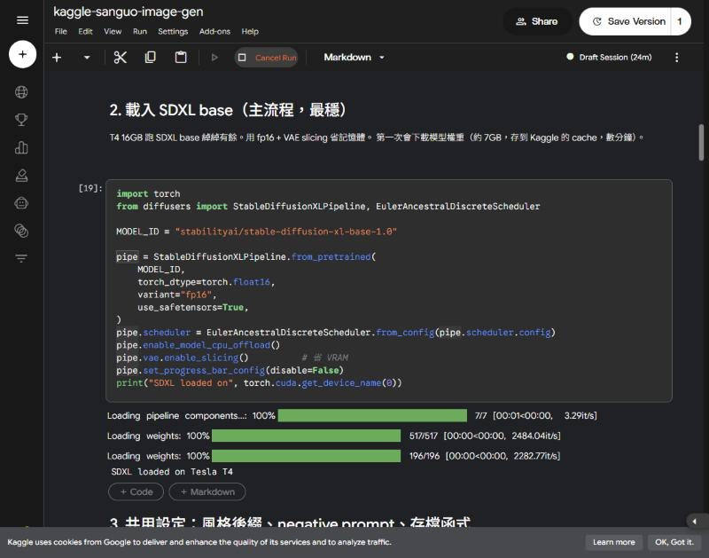
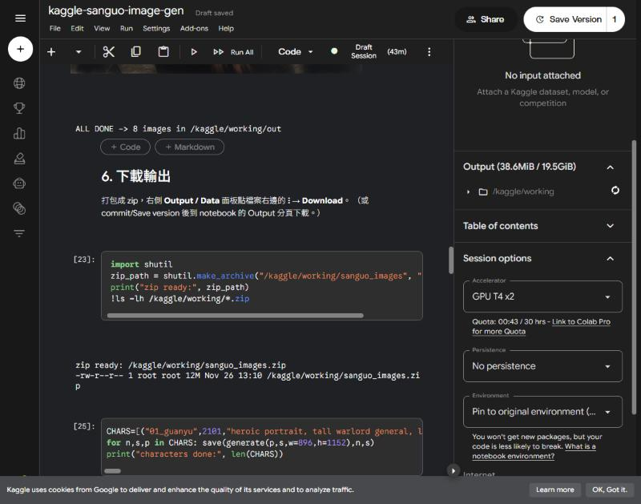
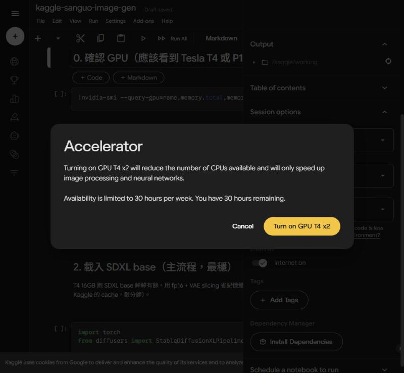

AI 影片裡偶爾要一張沒有版權疑慮的配圖——三國人物、場景之類。與其找圖，我試試能不能用**免費的 Kaggle GPU，配可商用的模型**直接生。

結論是：生得出來，而且很快。

<figure>
  
  <figcaption>SDXL 直接生出來的三國武將，檔名都帶 seed，方便複現。</figcaption>
</figure>

用 SDXL base 1.0，單張 30 步實測 **31～34 秒**（T4 上大約 1 秒跑一步）；加上模型搬移、VAE 解碼、存檔，單張大概 35 秒。
**10 張三國人物，從按下執行到「characters done: 10」約 6 分鐘。**

<figure>
  
  <figcaption>notebook 跑完的結果：最後一張存檔、印出「characters done: 10」。</figcaption>
</figure>

| 項目 | 時間 | 來源 |
|---|---|---|
| 單張 SDXL（30 步） | 31–34 秒 | 實測（步進條 ~1 s/it） |
| 單張 wall-clock（含搬移/解碼/存檔） | ~35 秒 | 估 |
| 10 張人物（執行→完成） | ~6 分鐘 | session 計時推估 |
| 權重下載（7.11GB） | ~25–35 秒 | 實測（283MB/s） |
| 環境初始化（排隊+裝套件+載入） | ~3–5 分鐘 | 估 |
| 本週消耗 quota | 47 分 / 30 小時 | 實測（面板） |
| ↳ 其中「有效生圖」 | ~15 分 | 估 |
搭環境、載入模型那段的過程大概長這樣：

<figure>
  
  <figcaption>① 開場 nvidia-smi 確認：拿到 2× Tesla T4（各 15GB）。</figcaption>
</figure>

<figure>
  
  <figcaption>② 下載 7.11GB 權重（283MB/s）；紅色那段是 diffusers 改版、enable_vae_slicing() 被拿掉噴的錯。</figcaption>
</figure>

<figure>
  
  <figcaption>③ 改成 vae.enable_slicing() 才跑得動：印出「SDXL loaded on Tesla T4」。</figcaption>
</figure>

> 中文字我乾脆不讓模型畫（用 negative prompt 擋掉，不然都是亂碼），標題之後再用 SVG 疊上去。

## Kaggle GPU 有免費額度限制

Kaggle 的 GPU 額度是**每週 30 小時、session 開著就計**，閒置也算。我停掉前面板顯示 `00:47 / 30 hrs`——這次花了 47 分鐘。

<figure>
  
  <figcaption>右側面板的額度：截圖時 00:43 / 30 hrs（停掉前到 47 分）；生圖只佔其中一小段。</figcaption>
</figure>

**真正在生圖的，大概只有 15 分鐘。** 其餘 32 分花在：GPU 排隊啟動、裝套件、下載並載入 **7.11GB** 的 SDXL 權重（還下了兩次，因為中途 Stop 重來），以及我把流程跑亂後的反覆重試。這段就是**沉沒成本**——燒掉了額度，沒換到一張圖。

機會成本也在這裡：每週就 30 小時，花在搭環境的每一分鐘，都是少掉的生圖額度。

<figure>
  
  <figcaption>Kaggle 官方寫得很白：「Availability is limited to 30 hours per week.」開 GPU 前就會跳這個。</figcaption>
</figure>

## 踩到的坑

- **採坑**：反覆重載 SDXL，把 16GB 記憶體吃爆（CUDA OOM），重啟核心還不釋放，得整個 Stop session、改用 `enable_model_cpu_offload()` 才解。
- 
- **真的是環境的**：`diffusers` 改版把 `enable_vae_slicing()` 拿掉了，直接噴錯，得改成 `vae.enable_slicing()`；還有第一個帳號沒做手機／身分驗證，GPU 跟 Internet 被鎖，換到驗證過的帳號重來。

## 外部風險，才是免費的真正代價

免費方案省的是錢，付的是**不可控**：

- Stop session 後 `/kaggle/working` 直接清空，那批圖只剩我先下載的 zip——**沒存下來就得整套重生**。
- 單次 session 上限約 12 小時，閒置 20～40 分自動停；要開 GPU 還得過身分驗證。
- 規則哪天一改、額度哪天縮，整條路就斷了。

這次是驗證可行，不是長期產線。之後若要穩定產，可以把生圖搬回 Cloudflare 技術棧（Workers AI 內建 flux-schnell，照官方公式估免費約每天 57 張）——下面那張 10 人 grid 就是用它生的。

用到的模型與授權：

| 模型 | 授權 | 這次用途 |
|---|---|---|
| SDXL base 1.0 | CreativeML OpenRAIL++-M（可商用） | 實際生圖 |
| FLUX.1-schnell | Apache-2.0（可商用） | 選配，沒實跑 |
| FLUX.1-dev | 非商用 | 明確避開 |

## 10張三國腳色

下面這張 10 位的 grid，**不是上面那套 Kaggle SDXL，而是用另一條免費路——Cloudflare Workers AI 的 FLUX-schnell 生的**（Kaggle 那批檔案沒留住，改用這條補生）。剛好當兩條免費路的對照。

<figure>
  
  <figcaption>關羽、張飛、趙雲、呂布、諸葛亮、劉備、曹操、孫權、周瑜、司馬懿。角色圖是 Workers AI（FLUX-schnell）生的、中文名牌事後用程式疊——畫面本身沒讓模型寫字。</figcaption>
</figure>

順手也用這 10 位做了支動態開場（Remotion 串的，每位依序登場）：

<figure>
  <video src="/bloger/images/kaggle-gpu-image-cost/sanguo-intro-web.mp4" controls muted playsinline preload="metadata"></video>
  <figcaption>10 位依序登場的無聲開場（關羽→…→司馬懿）。Remotion 做的，角色圖是 Workers AI 生的、中文名一樣是 Remotion 事後疊、沒讓模型寫字。</figcaption>
</figure>